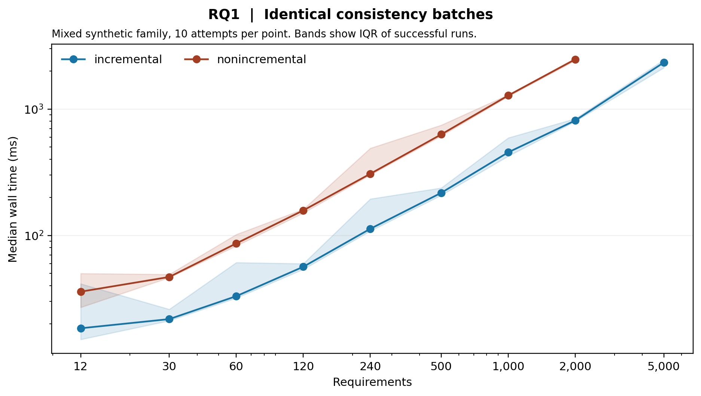
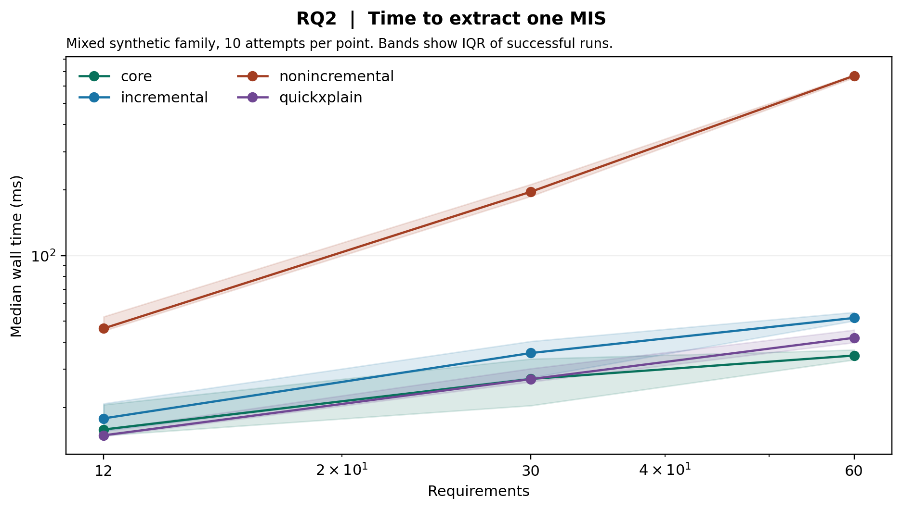
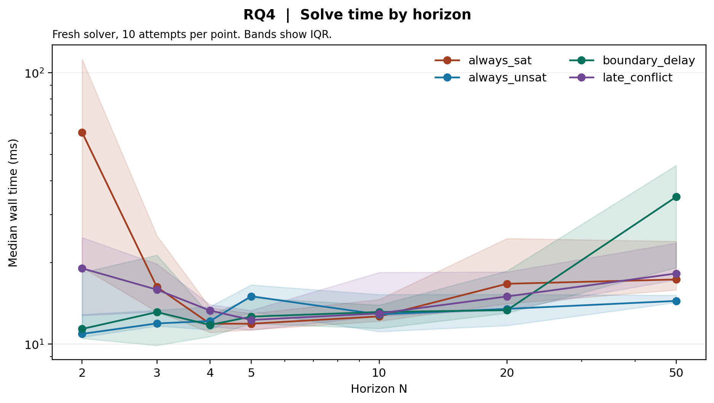
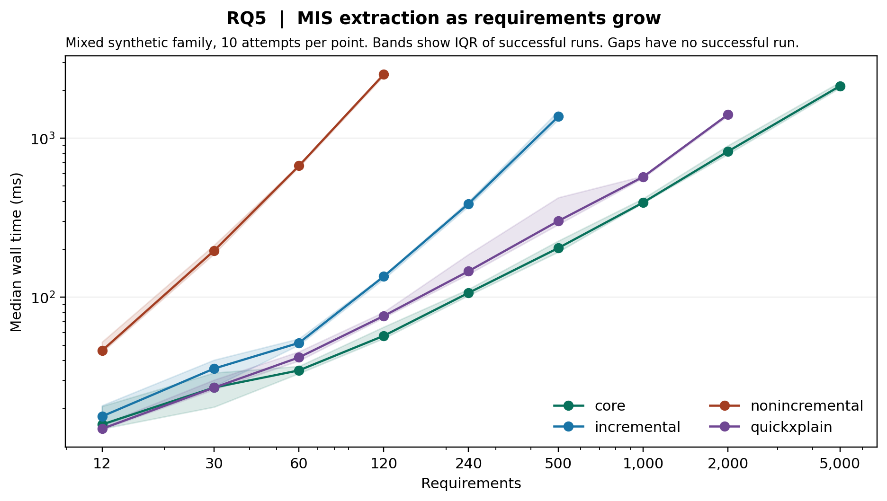

درس روش‌های رسمی · تیم ۳ · گزارش فنی و بستهٔ بازتولید

**عنوان انگلیسی**

Real-Time Requirements Consistency Checking and Minimal Inconsistent Subset (MIS) Extraction

## چکیده

وقتی چند واحد مهندسی برای یک سامانه نیازمندی می‌نویسند، ممکن است هر قاعده به تنهایی قابل اجرا باشد و ترکیب بعضی قواعد امکان هرگونه رفتار را از بین ببرد. ابزار این پروژه پنج الگوی زمانی بولی را روی ردهای گسسته و محدود مدل می‌کند، سازگاری را با Z3 می‌سنجد و در صورت ناسازگاری یک توضیح کمینه برحسب شناسهٔ قواعد تحویل می‌دهد. دو روش بررسی سازگاری و چهار روش استخراج با ورودی، بودجه و سخت‌افزار یکسان ارزیابی شدند. ارزیاب مستقیم Python نتیجه‌های منطقی و خروجی‌های MIS را مستقل از رمزگذاری Z3 بررسی کرد.

<!-- SUMMARY:start -->

در مطالعهٔ نهایی 58 مورد متمایز و 2,360 اجرا ثبت شد. 2,250 اجرا موفق و 110 اجرا دچار timeout شدند. در خانوادهٔ مقیاس، میانهٔ سرعت نسبی افزایشی در جفت‌های موفق از 1.70 تا 3.17 برابر بود. 744 خروجی MIS کنترل کمینگی را گذراندند. نسخهٔ آزموده‌شده Python `3.12.14` و Z3 `4.15.4` روی Linux بود.

<!-- SUMMARY:end -->

## ۱. مسئله و هدف

در یک کنترل‌کننده، درخواست و تأیید را در نظر بگیرید. اگر وجود درخواست الزامی باشد، تأیید در زمانی محدود لازم شود و قاعدهٔ سوم تأیید را در کل رد منع کند، هر رفتار پیشنهادی دست‌کم یکی از قواعد را نقض می‌کند. تعیین این سه قاعده برای بازبینی مهندسی دقیق‌تر از برچسب کلی ناسازگاری است. درعین‌حال، اگر درخواست هیچ‌وقت رخ ندهد، قاعدهٔ پاسخ ارضای تهی دارد و ممکن است دو قاعدهٔ باقی‌مانده سازگار باشند.

پرسش اصلی این است که کدام روش در دسته‌های تکراری کار کمتری انجام می‌دهد و آیا هزینهٔ استخراج با تعداد قواعد به شکلی رشد می‌کند که روی یک CPU معمولی قابل استفاده باشد. هدف دیگر ارزیابی اثر افق است. گزارش جداگانهٔ تغییر جواب منطقی و تغییر زمان اجرا به ما اجازه می‌دهد یک تضاد وابسته به رخداد را از محدودیت پایان رد تشخیص دهیم.

<div class="page-break"></div>

## ۲. معنای مدل و الگوها

روش‌های رسمی از مدل دقیق و قواعد استنتاج برای پاسخ به پرسش‌های سیستم استفاده می‌کنند. SMT بررسی ارضاپذیری فرمول‌ها را در حضور نظریه‌ها ممکن می‌کند. این مدل فقط از بخش بولی Z3 استفاده می‌کند. اگر $T = \{0,\ldots,N\}$ باشد، مقدار سیگنال $x$ در زمان $t$ با $x_t$ نمایش داده می‌شود. یک رد کامل مقدار تمام متغیرهای مدل را تعیین می‌کند. SAT وجود دست‌کم یک رد با تمامی قیود است. UNSAT نبود چنین ردی، و UNKNOWN جواب نامعین حل‌کننده تحت تنظیمات همان اجراست.

| الگو | فرمول شرط |
|---|---|
| Invariant | $\bigwedge_{t=0}^{N} x_t$ |
| Absence | $\bigwedge_{t=0}^{N} \neg x_t$ |
| Response | $\bigwedge_{t=0}^{N} (a_t \Rightarrow \bigvee_{j=t}^{\min(t+d,N)} b_j)$ |
| Recurrence | $\bigwedge_{s=0}^{N-w+1} \bigvee_{j=s}^{s+w-1} x_j$ |
| Bounded delay | $\bigwedge_{t=0}^{N} (a_t \Rightarrow \bigvee_{j=t+l}^{\min(t+u,N)} b_j)$ |

افق $N$ اندیس آخر است. افق صفر یک نمونه دارد. پنجرهٔ recurrence فقط روی قسمت کامل رد حرکت می‌کند. deadline صفر پاسخ در همان گام را ممکن می‌کند. در تأخیر مثبت، اگر کمترین زمان پاسخ بعد از $N$ باشد، محرک در آن نقطه باید کاذب باشد. برای مثال با $N=3$، محرک قطعی در گام ۲ و تأخیر دقیق ۲، هیچ خانه‌ای برای پاسخ وجود ندارد. با $N=4$، پاسخ در گام ۴ شاهد SAT می‌سازد.

مشاهده، مانند «درخواست در گام ۳ رخ داده است»، جزء محیط ثابت است. از آن در همهٔ زیرمجموعه‌ها استفاده می‌شود. نبود محرک موجب ارضای تهی response و bounded_delay می‌شود. همین موضوع ضرورت تعریف رخدادهای محیط و بازبینی نمونه‌های SAT را نشان می‌دهد. برای هر الگو نمونه، حالت مرزی و مثال ناسازگار در [راهنمای الگوها](../docs/TEMPORAL_PATTERNS.md) موجود است.

<div class="page-break"></div>

## ۳. الگوریتم‌ها و معماری

### ۳.۱ بررسی با حل‌کنندهٔ تازه و افزایشی

برای هر زیرمجموعه، روش غیرافزایشی رد نمادین، مشاهدات و قیود انتخاب‌شده را در یک حل‌کنندهٔ تازه می‌سازد. در روش افزایشی، هر قاعدهٔ $r$ تنها یک بار با شرط $a_r \Rightarrow F_r$ اضافه می‌شود. دستور check پرچم قواعد منتخب را فرض می‌کند. برای قواعد غیرفعال، قراردادن پرچم در false اثرشان را خنثی می‌کند. بنابراین هر رد از روش تازه به روش افزایشی قابل گسترش است، و هر مدل افزایشی پس از کنارگذاشتن پرچم‌ها قیود انتخابی را ارضا می‌کند.

### ۳.۲ استخراج یک MIS

یک مجموعهٔ $M$ زمانی MIS است که $O\land\bigwedge_{r\in M} F_r$ ناسازگار باشد و حذف هر عضو آن فرمول سازگار بسازد. این تعریف کمینگی بر اساس شمول است. ممکن است یک ورودی چند MIS با اندازه‌های مختلف داشته باشد. Core هستهٔ یک برهان ناسازگاری است و می‌تواند فرمول‌های زائد داشته باشد.

| روش | عملیات اصلی |
|---|---|
| Non-incremental deletion | حذف آزمایشی قواعد با ساخت حل‌کنندهٔ تازه در هر مرحله |
| Incremental deletion | همان حذف با فراخوانی assumptions در یک حل‌کننده |
| Core + deletion | گرفتن Core، بازگرداندن شناسه‌ها و حذف در همان حل‌کننده |
| QuickXplain | تقسیم نامزدها و آزمون ناسازگاری پس‌زمینه برای کوچک کردن هر نیمه |

در حذف تکراری، نتیجهٔ کل UNSAT در هر مرحله حفظ می‌شود. اگر یک حذف SAT دهد، مجموعه‌های بعدی بدون همان عضو همچنان زیرمجموعهٔ همان شاهد SAT هستند. بنابراین در پایان حذف هیچ عضو باقی‌مانده‌ای UNSAT نمی‌دهد. QuickXplain نیز یک مجموعهٔ کمینه می‌دهد و به ترتیب قواعد حساس است. MARCO برای شمارش چند MIS و مجموعه‌های سازگار بیشینه طراحی شده است. پوشش تجربی حاضر زمان یافتن یک MIS را اندازه می‌گیرد.

ورودی JSON در `dataio.py` اعتبارسنجی می‌شود. `model.py` رمزگذاری، `solver.py` بررسی و `mis.py` استخراج را انجام می‌دهند. CLI روش‌ها را در دسترس قرار می‌دهد. مطالعهٔ CPU از worker جداگانه برای هر عملیات بهره می‌گیرد و اسکریپت‌های تحلیل CSV را مستقیماً می‌خوانند.

<div class="page-break"></div>

## ۴. داده‌ها و منشأ

آزمایش اصلی خانوادهٔ مقیاس Mixed، خانواده‌های varied با اندازهٔ تزریق ۲ تا ۴، حالت Simple و نمونه‌های SAT مصنوعی را در بر می‌گیرد. در Simple هر قید پس‌زمینه یک سیگنال مستقل را خاموش می‌کند. در Mixed، هر گروه از سیگنال مستقل به‌صورت روشن، تأیید و خطا ساخته می‌شود. روشن و تأیید روی کل رد true و خطا false هستند، در نتیجه invariant، recurrence، پاسخ با مهلت و تأخیر با کمینهٔ صفر در پس‌زمینه به‌صورت مشترک ارضا می‌شوند. گونهٔ varied سه پارامتر زمانی را از seed می‌گیرد و همچنان شاهد ثابتی برای پس‌زمینه دارد.

| هستهٔ تزریق | مثال آموزشی |
|---|---|
| ۲ عضو | سیگنال alarm همیشه روشن و همیشه خاموش باشد. |
| ۳ عضو | درخواست یک‌بار اجباری است، هر درخواست تأیید می‌خواهد و تأیید همیشه غایب است. |
| ۴ عضو | a اجباری است، a فوراً b می‌خواهد، b فوراً c می‌خواهد و c غایب است. |

حذف هر عضو در هسته، زنجیره یا رابطهٔ متضاد را قطع می‌کند. پس‌زمینه از سیگنال‌های هسته مستقل است. بنابراین برای این مولد، اگر یک زیرمجموعهٔ ناسازگار همهٔ اعضای هسته را نداشته باشد، وجود شاهد برای هر مؤلفه به شاهد مشترک می‌انجامد و تناقض رخ نمی‌دهد. در آزمون‌های دستی جداگانه اندازهٔ پنجره، گام آخر، رخداد محیطی و ارضای تهی عمداً انتخاب شده‌اند. دو اجرای ۱۰٬۰۰۰ قیدی Windows با روش Core در بایگانی تاریخی قابل دسترسی‌اند.

ورودی‌های عمومی از نمونه‌های FRET Liquid Mixer و Hanfor انتخاب شدند. دو قید مثبت با پاسخ فوری FRET به response هم‌گام منتقل شدند. دو قید تک‌بیتی Hanfor به invariant و absence منتقل شدند. فهرست موارد حذف‌شده، نسخه‌ها، مسیر فایل اصلی و مجوز هر نمونه در [راهنمای داده](../docs/DATASET_GUIDE.md) قرار دارد. انتقال FRET شرط بولی را در هر گام می‌سنجد و می‌تواند از معناشناسی شروع رخداد قوی‌تر باشد. زمان و منطق روی دو زیرمجموعهٔ انتخابی اندازه گرفته شدند.

<div class="page-break"></div>

## ۵. طراحی مطالعه و معیارها

هر عملیات در یک پردازش تازه به‌صورت متوالی اجرا شد. روش‌ها در هر تکرار جای خود را به‌صورت چرخشی عوض کردند. محدودهٔ هر فراخوانی Z3، سقف بدنهٔ فرایند، میزان حافظه و Seed در فایل تنظیمات ثبت شدند. زمان اصلی شامل ساخت فرمول و حل است. هزینهٔ بارگذاری JSON و فرایند در زمان worker وارد می‌شود. اعتبارسنجی MIS بعد از زمان استخراج انجام شد و بودجهٔ کل پردازش همچنان روی آن اعمال شد.

سه عدد خواندن نتایج را ساده می‌کنند. **سرعت نسبی**، نسبت زمان غیرافزایشی به زمان روش مقایسه است. برای هر مورد، نسبت‌ها در تکرارهای موفقِ مشترک محاسبه و میانه می‌شوند. **اعتبار MIS**، تعداد خروجی‌های صحیح و کمینه در میان نامزدهایی است که کنترلشان نتیجهٔ قطعی داده است. برای روشن‌بودن اثر timeout، تعداد MIS معتبر بر تمام تلاش‌های برنامه‌ریزی‌شدهٔ UNSAT نیز گزارش می‌شود. **بازیابی تزریق برحسب مورد**، تعداد مجموعه‌های مصنوعی است که MIS تزریقی در دست‌کم یک تکرار دقیق بازیابی شده، تقسیم بر تعداد مجموعه‌های تزریقی برنامه‌ریزی‌شده برای همان روش. نرخ بازیابی برحسب تلاش، مخرج جدا دارد.

آمار توصیفی شامل میانه، میانگین، انحراف معیار، کمینه، بیشینه و IQR است. برای تحلیل اکتشافی، ابتدا میانهٔ زمان هر روش روی هر ورودی مصنوعی ۳۰ قیدی محاسبه شد. سپس آزمون Wilcoxon دوطرفه و اصلاح Holm برای مقایسه‌های جفت‌شده، بازهٔ ۹۵٪ bootstrap بازنمونه‌گیری موارد و A12 روی میانه‌ها محاسبه شدند. A12 به سهم زوج‌های سریع‌تر و نیم وزن تساوی اشاره دارد. وابستگی خانواده‌های طراحی‌شده و تعداد محدود موارد دامنهٔ تفسیر استنباطی را محدود می‌کند.

<!-- INFERENCE:start -->

| پرسش و روش | مورد | نسبت میانه | ۹۵٪ bootstrap | A12 | Wilcoxon | Holm |
| --- | --- | --- | --- | --- | --- | --- |
| rq1 / incremental | 5 | 2.15 | 2.08–2.96 | 0.88 | 0.062 | 0.250 |
| mis / incremental | 5 | 7.48 | 5.51–10.69 | 1.00 | 0.062 | 0.250 |
| mis / core | 5 | 8.12 | 7.13–12.43 | 1.00 | 0.062 | 0.250 |
| mis / quickxplain | 5 | 7.25 | 6.31–17.49 | 1.00 | 0.062 | 0.250 |

شرایط اجرا: seed حل‌کننده 17، 10 تکرار، مهلت هر فراخوانی 700 ms، مهلت کل 3 s و سقف فضای آدرس 768 MiB. پردازندهٔ گزارش‌شده `INTEL(R) XEON(R) PLATINUM 8573C` است. تنظیمات کامل و مشخصات محیط در JSON شواهد ثبت‌اند.

<!-- INFERENCE:end -->

<div class="page-break"></div>

## ۶. RQ1 — هزینهٔ بررسی سازگاری

هر دو روش یک ترتیب منطقی یکسان دارند. در موارد تزریقی، کل ورودی و حذف یک قید پس‌زمینه UNSAT می‌مانند. حذف دو قید تزریقی به صورت دو آزمایش جدا، دو نتیجهٔ SAT می‌دهد. ساخت حل‌کننده و زمان Z3 جدا ثبت می‌شوند تا معلوم شود اختلاف زمان کل به چه مرحله‌ای مربوط است. موارد دستی، عمومی و SAT مصنوعی یک پرس‌وجوی کل دارند. مقایسهٔ مستقیم دسته‌های چهارگانه با موارد تک‌پرس‌وجو تفسیر جدا می‌خواهد.

<!-- RQ1:start -->

| قواعد | کل تازه | کل افزایشی | ساخت تازه | ساخت افزایشی | نسبت (جفت) | موفق تازه | موفق افزایشی |
| --- | --- | --- | --- | --- | --- | --- | --- |
| 12 | 35.93 | 18.45 | 32.34 | 16.99 | 1.70× (10) | 10/10 | 10/10 |
| 60 | 86.50 | 33.11 | 81.81 | 28.20 | 2.64× (10) | 10/10 | 10/10 |
| 500 | 630.13 | 217.47 | 604.77 | 181.65 | 3.17× (10) | 10/10 | 10/10 |
| 1000 | 1280.89 | 455.01 | 1235.02 | 388.76 | 2.75× (10) | 10/10 | 10/10 |
| 5000 | — | 2336.02 | — | 1935.16 | — | 0/10 | 6/10 |

زمان‌های جدول برحسب میلی‌ثانیه‌اند. در ۶۰ قید، میانهٔ زمان خود Z3 برای روش تازه 3.83 و برای افزایشی 4.78 میلی‌ثانیه بود. سرعت‌های جدول از زوج‌های موفق به دست آمده‌اند.

<!-- RQ1:end -->



<div class="page-break"></div>

## ۷. RQ2 و RQ3 — زمان، اندازه و درستی MIS

مقایسهٔ زمان روی موارد UNSAT مشخص می‌کند کدام روش زودتر یک توضیح می‌دهد. q=تعداد فراخوانی Z3 برای استخراج است و کنترل مجدد عضوها جدا ثبت می‌شود. اگر Core اولیه کوچک باشد، حذف تکراری به تعداد اعضای Core وابسته می‌شود. QuickXplain از تقسیم فعال‌سازها بهره می‌گیرد و پس از پیدا شدن پس‌زمینهٔ ناسازگار، برخی شاخه‌ها بدون آزمودن حذف هر عضو کنار می‌روند.

<!-- RQ23:start -->

| روش | میانه ms | فراخوانی Z3 | اندازه MIS | اندازه Core |
| --- | --- | --- | --- | --- |
| core | 34.69 | 4 | 3 | 3 |
| incremental | 51.64 | 61 | 3 | — |
| nonincremental | 670.01 | 61 | 3 | — |
| quickxplain | 41.85 | 27 | 3 | — |

| روش | MIS معتبر / تلاش UNSAT | MIS معتبر / بررسی قطعی | تزریق‌های بازیابی‌شده / موردها |
| --- | --- | --- | --- |
| core | 208/210 | 208/208 | 16/16 |
| incremental | 180/210 | 180/180 | 13/16 |
| nonincremental | 156/210 | 156/156 | 11/16 |
| quickxplain | 200/210 | 200/200 | 15/16 |

<!-- RQ23:end -->



<div class="page-break"></div>

## ۸. RQ4 — اثر افق زمانی

دو کنترل ثابت طراحی شدند. در Always SAT دو سیگنال مستقل خاموش‌اند. در Always UNSAT یک سیگنال همواره روشن و خاموش خواسته می‌شود. در Late Conflict، مشاهدهٔ درخواست در گام ۳ از افق ۳ وارد مدل می‌شود. پاسخ باید ظرف یک گام باشد و grant غایب است. کوچک شدن افق تا ۲ مشاهده را از مدل حذف می‌کند. پس از ورود مشاهده، تضاد حتی با پنجرهٔ کامل پاسخ باقی می‌ماند.

در Boundary Delay، مشاهدهٔ محرک در گام ۲ و پاسخ دقیقاً دو گام بعد است. در افق‌های ۲ و ۳، راه پاسخ بیرون رد است. در افق ۴ و بیشتر، خانهٔ پاسخ وجود دارد و یک رد سازگار ساخته می‌شود. این کنترل اثر قرارداد مرزی را مستقل از late conflict روشن می‌کند. در کل چهار سناریو، قواعد زمانی با تغییر N ثابت‌اند. فقط مشاهدات خارج از رد ثبت‌شده وارد فرمول آن افق نمی‌شوند.

<!-- RQ4:start -->

| سناریو | 2 | 3 | 4 | 5 | 10 | 20 | 50 |
| --- | --- | --- | --- | --- | --- | --- | --- |
| always_sat | sat | sat | sat | sat | sat | sat | sat |
| always_unsat | unsat | unsat | unsat | unsat | unsat | unsat | unsat |
| boundary_delay | unsat | unsat | sat | sat | sat | sat | sat |
| late_conflict | sat | unsat | unsat | unsat | unsat | unsat | unsat |

مقادیر جدول از اجراهای موفق با Solver تازه آمده‌اند. جدول خام افزایشی و تازه را برای هر تکرار ثبت کرده است.

<!-- RQ4:end -->



<div class="page-break"></div>

## ۹. RQ5 — رشد تعداد نیازمندی

خانوادهٔ Mixed و تزریق سه‌عضوی ثابت، محور تغییر اندازه را فراهم می‌کنند. افزایش اندازه، پیچیدگی الگوی پس‌زمینه را هم از نظر تعداد گروه‌های مستقل زیاد می‌کند. روش حذفی تازه چندین بار مجموعهٔ بزرگی از فرمول‌ها را بازسازی می‌کند. روش افزایشی هزینهٔ بازسازی را حذف می‌کند، ولی هنوز می‌تواند تعداد زیادی زیربررسی داشته باشد. Core و QuickXplain مقدار کاری را که باید پس از تشخیص UNSAT انجام شود تغییر می‌دهند.

<!-- RQ5:start -->

| قواعد | nonincremental | incremental | core | quickxplain |
| --- | --- | --- | --- | --- |
| 12 | 46.21 (10/10) | 17.83 (10/10) | 15.85 (10/10) | 14.90 (10/10) |
| 30 | 196.36 (10/10) | 35.62 (10/10) | 27.08 (10/10) | 27.03 (10/10) |
| 60 | 670.01 (10/10) | 51.64 (10/10) | 34.69 (10/10) | 41.85 (10/10) |
| 120 | 2514.59 (7/10) | 135.09 (10/10) | 57.21 (10/10) | 76.31 (10/10) |
| 240 | — (0/10) | 387.13 (10/10) | 106.51 (10/10) | 145.83 (10/10) |
| 500 | — (0/10) | 1367.41 (10/10) | 203.89 (10/10) | 301.54 (10/10) |
| 1000 | — (0/10) | — (0/10) | 393.96 (10/10) | 570.94 (10/10) |
| 2000 | — (0/10) | — (0/10) | 824.84 (10/10) | 1406.00 (10/10) |
| 5000 | — (0/10) | — (0/10) | 2127.31 (8/10) | — (0/10) |

هر خانه میانهٔ میلی‌ثانیهٔ اجرای موفق و (موفق/تلاش) را نشان می‌دهد. برای شکست‌ها، ستون وضعیت CSV حفظ شده است.

<!-- RQ5:end -->



<div class="page-break"></div>

## ۱۰. اعتبارسنجی، خطا و مقایسهٔ خارجی

در اعتبارسنج مستقل، ابتدا مشاهدات و قیدهای invariant و absence به سلول‌های ثابت در رد تبدیل می‌شوند. سپس روابط سیگنال‌ها مؤلفه‌های مستقل می‌سازند. زمانی که یک مؤلفه شاهد سازگار دارد، مقدارهای آن با شاهد مؤلفه‌های دیگر جمع می‌شوند. برای مؤلفه‌های کوچک، خانه‌های آزاد با شمارش تمام انتساب‌ها بررسی می‌شوند. هر قاعده مستقیماً روی بردار مقادیر زمانی معنا می‌شود. یک MIS با مقایسهٔ عضویت، کنترل UNSAT کل و کنترل SAT بعد از حذف هر عضو سنجیده شد. نتایج شکست یا توقف در CSV باقی مانده‌اند.

<!-- VALIDATION:start -->

اعتبارسنج مستقل 329 کنترل موفق و 0 اختلاف ثبت کرد. شمار موارد بررسی‌ناپذیر تحت سقف شمارش 0 بود. در پایلوت، افزایشی در 4 از 4 مورد و Core در 3 از 4 مورد به معیار سرعتِ قوی‌ترین baseline داخلی رسید. کنترل‌های مستقل پایلوت در CSV جدا ثبت شدند.

<!-- VALIDATION:end -->

### وضعیت ابزارهای دیگر

FRET یک زبان کنترل‌شده برای تعریف نیازمندی و ابزار تشریح، شبیه‌سازی و تحلیل تحقق‌پذیری است. Hanfor نیازمندی‌ها را رسمی می‌کند و می‌تواند تحلیل پیشوندهای مسدودکنندهٔ تداوم را به Ultimate بسپارد. در این پروژه پرسش وجود یک رد کامل با افق مشخص است. هیچ زمان منتشرشدهٔ خارجی برای تخمین نسبت سرعت در اجراهای حاضر استفاده نشده است. وضعیت نسخه، نصب و تلاش اجرا در [گزارش baseline](../docs/BASELINE_VERIFICATION.md) آمده است.

### محدودیت‌ها

نتایج به افق محدود، نمونه‌های بولی، خانوادهٔ مصنوعی با مؤلفه‌های مستقل، دو زیرمجموعهٔ عمومی بسیار کوچک و سخت‌افزار مطالعه مربوط‌اند. ویژگی‌های تحمیل‌شده در افق، رفتار پیش از اولین نمونه و میان دو نمونه را تعیین نمی‌کنند. بیشتر داده‌های بزرگ یک هستهٔ کاشته‌شدهٔ کوچک دارند. اندازهٔ Core، نظر حل‌کننده دربارهٔ ساختار فرمول و ترتیب ورودی می‌توانند سختی نمونه‌های آینده را تغییر دهند. نسبت‌های زمان از اجراهای موفق مشترک حاصل می‌شوند و گزارش وضعیت برای تفسیر کامل لازم است.

<div class="page-break"></div>

## ۱۱. نتیجه‌گیری و بازتولید

استفادهٔ مجدد از Solver در کار تکراری هزینهٔ رمزگذاری و ساخت را کاهش می‌دهد. روش Core و کوچک‌سازی افزایشی به‌ویژه وقتی تضاد در بخش کوچکی از قیود متمرکز است تعداد بررسی‌ها را کاهش می‌دهد. QuickXplain یک روش معتبر مقایسه‌ای است و در برخی نمونه‌ها سبک‌تر اجرا می‌شود. وابستگی به افق را باید در نتیجه گزارش کرد: یک تضاد ناشی از نبود خانهٔ پاسخ می‌تواند با افزودن گام برطرف شود، در حالی که تضاد مشاهده‌شدهٔ درخواست و منع پاسخ با گسترش افق هم پابرجاست.

پایلوت با قاعدهٔ «سریع‌تر یا هم‌سطح در دست‌کم نیمی از موارد» و وجود شاهد اعتبارسنج مستقل سنجیده شد. وضعیت جلسهٔ رسمی و پذیرش جایگزین مقایسهٔ خارجی به تصمیم استاد وابسته است. گزارش نتایج محلی، ورودی‌ها، تحلیل، و وضعیت مانع‌ها در بستهٔ تحویل ثبت شده است.

```bash
bash setup.sh
bash scripts/run_project.sh demo
bash scripts/run_project.sh test
bash scripts/run_project.sh pilot
bash scripts/run_project.sh full
python analysis/analyze_results.py --study results/final
```

### منابع منتخب

- de Moura و Bjørner، *Z3: An Efficient SMT Solver*، TACAS 2008. [مقاله](https://doi.org/10.1007/978-3-540-78800-3_24)
- Dwyer، Avrunin و Corbett، الگوهای بررسی متناهی، ICSE 1999. [مقاله](https://doi.org/10.1145/302405.302672)
- Konrad و Cheng، الگوهای مشخصات زمان‌حقیقی، ICSE 2005. [مقاله](https://doi.org/10.1145/1062455.1062526)
- Junker، *QuickXplain*، AAAI 2004. [مقاله](https://aaai.org/Papers/AAAI/2004/AAAI04-027.pdf)
- Liffiton و همکاران، *Fast, Flexible MUS Enumeration*. [نویسنده و کد](https://markliffiton.com/marco/)
- Giannakopoulou و همکاران، *Formal Requirements Elicitation with FRET*. [NASA](https://ntrs.nasa.gov/citations/20200001989)
- مستندات و مقالات روش rt-inconsistency. [Hanfor](https://ultimate-pa.github.io/hanfor/introduction/index.html)
- [فهرست کامل منابع و نسخه‌ها](../docs/REFERENCES.md)
