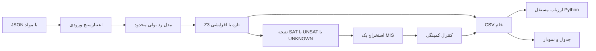
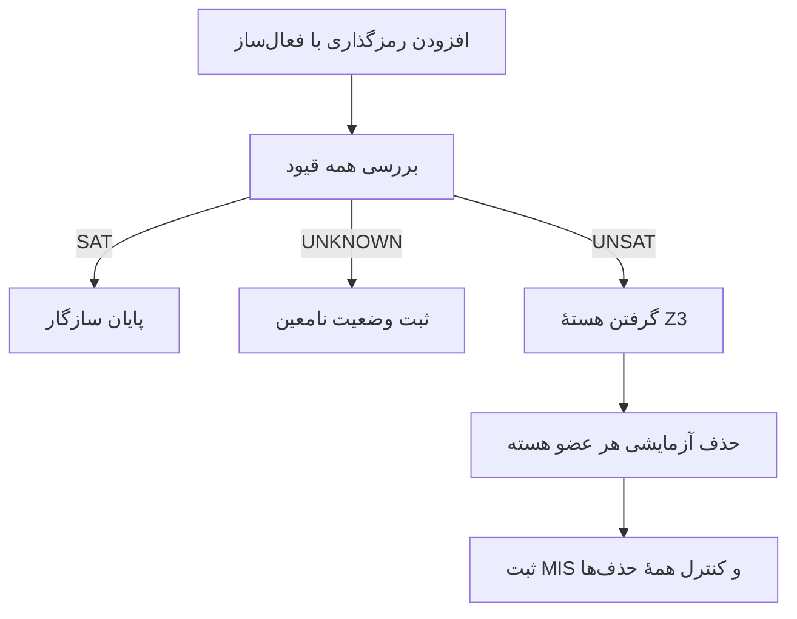

# مواد ارائهٔ تیم ۳

## طرح ۱۵ دقیقه‌ای

| اسلاید | مطلب | عضو و زمان |
|---|---|---|
| ۱. مسئله | تضاد درخواست و پاسخ در یک سیستم زمان‌دار، هدف پیدا کردن قیدهای مسبب | نفر اول، ۱ دقیقه |
| ۲. مدل | زمان ۰ تا N، الگوهای بولی، بررسی SAT روی یک رد، مثال deadline صفر | نفر اول، ۲ دقیقه |
| ۳. استخراج | تعریف MIS و Core، مقایسهٔ چهار روش، مثال‌های ۲ تا ۴ عضو | نفر اول، ۲ دقیقه |
| ۴. داده و بودجه | پس‌زمینهٔ سازگار، تزریق معلوم، موارد دستی و دو زیرمجموعهٔ عمومی | نفر دوم، ۲ دقیقه |
| ۵. RQ1 و RQ2 | زمان گروه بررسی‌ها و زمان یک MIS | نفر دوم، ۲ دقیقه |
| ۶. RQ3 | اعتبارسنجی مستقل و بازیابی دقیق، مخرج هر دو معیار | نفر سوم، ۲ دقیقه |
| ۷. RQ4 و RQ5 | نمودار افق و وضعیت، نمودار مقیاس و توقف‌ها | نفر سوم، ۲ دقیقه |
| ۸. جمع‌بندی | محدودیت مدل، ابزار خارجی، جایگاه نتیجهٔ pilot و روش بازتولید | نفر سوم، ۲ دقیقه |

## مثال‌های روی تخته

- SAT. درخواست غایب و الزامی برای وقوع آن وجود ندارد. الزام پاسخ در دو گام به‌صورت تهی ارضا می‌شود.
- MIS دو عضوی. آژیر همیشه روشن و آژیر همیشه خاموش. هر دو با هم UNSAT، هر کدام به تنهایی SAT.
- MIS سه عضوی. رخداد درخواست اجباری، درخواست نیازمند تأیید، و تأیید ممنوع. سه حذف ممکن را با سه رد ساده توضیح دهید.
- MIS چهار عضوی. a همیشه روشن، a در همان گام b می‌خواهد، b در همان گام c می‌خواهد، و c ممنوع است.
- افق. در گام ۲ رخداد قطعی است و پاسخ دقیقاً دو گام بعد لازم است. N=3 پاسخ ندارد و N=4 شاهد دارد.

## نمودار معماری



## مسیر Core و شبه‌کد



```text
check_fresh(S): build a new solver from S and fixed observations
check_incremental(S): call one prepared solver with enable flags for S
delete(C): for each r in original C, drop r if check(C minus r) is UNSAT
core: call incremental with all flags, then delete(core)
QuickXplain: split candidates; explain each half in the context of the other half
validate(M): confirm input membership, check UNSAT, then require SAT after each deletion
```

## نمودارها و پیام شفاهی

| پرسش | تصویر یا جدول | جملهٔ ارائه |
|---|---|---|
| RQ1 | [زمان دسته](../results/final/figures/rq1_consistency.svg) و [سرعت نسبی](../results/final/figures/rq1_speedup.svg) | Solver افزایشی ساخت را بین پرس‌وجوهای یک دسته به اشتراک می‌گذارد. |
| RQ2 | [زمان MIS](../results/final/figures/rq2_mis_time.svg) و [اندازه](../results/final/summary/rq2_mis_timing_and_size.csv) | Core می‌تواند فضای حذف را کوچک کند. QuickXplain تعداد پرس‌وجوها را با تقسیم کاهش می‌دهد. |
| RQ3 | [کمینگی و بازیابی](../results/final/summary/rq3_correctness.csv) | اعتبار MIS میان نامزدها و پوشش در میان همهٔ تلاش‌ها را جدا توضیح دهید. |
| RQ4 | [نقشهٔ SAT/UNSAT](../results/final/figures/rq4_status.svg) و [زمان](../results/final/figures/rq4_bound_timing.svg) | مرز افق و رخداد دیرهنگام دو علت متمایز تغییر پاسخ‌اند. |
| RQ5 | [مقیاس زمان](../results/final/figures/rq5_scalability.svg) و [شمار توقف](../results/final/figures/rq5_status.svg) | هر اندازه را همراه با تعداد عملیات موفق و بودجهٔ یکسان بخوانید. |

اعداد و جدول‌های مناسب اسلاید در [گزارش فنی](FINAL_REPORT_FA.md) و فایل‌های لینک‌شده قرار دارند. یادداشت دفاع برای پرسش‌های محتمل در [راهنمای دفاع](DEFENSE_GUIDE_FA.md) است. هر عضو پیش از ارائه Demo را اجرا کند و یک ردیف خام را به نمودار ردیابی کند.
